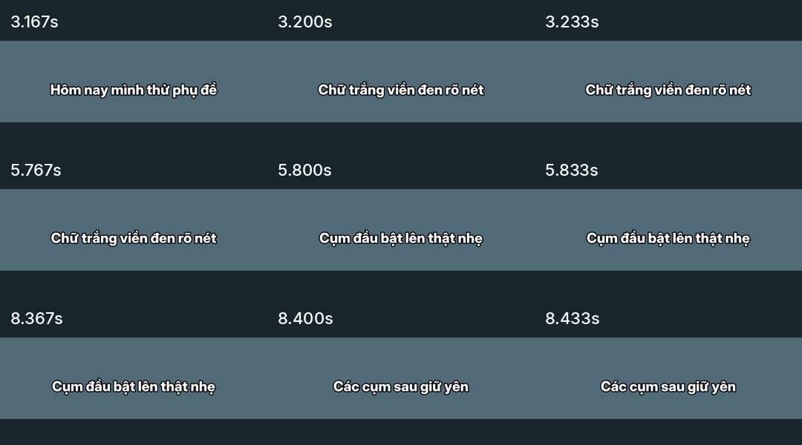

# Phụ đề chuyển cụm liên tục — không khoảng trống

- [skill.md mới](skill.md) — hướng dẫn và mã thực thi đã cập nhật.
- [Video test mới](demo.mp4) — 11,4 giây, 720×1280, H.264 Baseline/AAC im lặng.
- [ASS](captions.ass), [SRT](captions.srt), [kết quả kiểm tra](TEST-RESULTS.txt).
- [Tải ZIP gồm skill và video](subtitle-demo.zip).

## Điểm thay đổi

Giữ cụm hiện tại trên màn hình đến đúng thời điểm cụm tiếp theo bắt đầu:
**end của cụm trước = start của cụm sau**, khoảng trống bằng 0 giây.
Mã trong skill tự lấp khoảng trống của input bằng cách kéo dài end, giữ nguyên
start để không đưa cụm sau lên trước lời nói. Không cắt hoặc tăng tốc audio.
Quy tắc áp dụng cả khi có khoảng nghỉ giữa các cụm; cụm cuối giữ end đã rà.

Chữ trắng viền đen, 5–6 từ/cụm, không nền; chỉ cụm đầu có pop-up nhẹ.
Các cụm tiếp theo thay trực tiếp, không fade và không chuyển động.

Đã kiểm tra **306 frame liên tục** từ 0,6 đến 10,8 giây: không có frame trống
giữa phụ đề. ASS và SRT cũng có ranh giới nối nhau chính xác. Khoảng trước cụm
đầu/sau cụm cuối không phải khoảng cách giữa các cụm.
Demo dùng timing đặt thủ công, không có giọng nói và không kiểm tra độ chính xác ASR.

## Tải file

- [Tải video MP4](https://github.com/StephenNgo420/VideoEdit/raw/refs/heads/main/examples/subtitle-continuous/demo.mp4)
- [Tải ZIP](https://github.com/StephenNgo420/VideoEdit/raw/refs/heads/main/examples/subtitle-continuous/subtitle-demo.zip)

Nếu không phát/tải trực tiếp, mở file trên GitHub rồi chọn **Download raw file**.
Thư mục `examples/subtitle-only` cũ đã được thay bằng bản này trên nhánh main.

