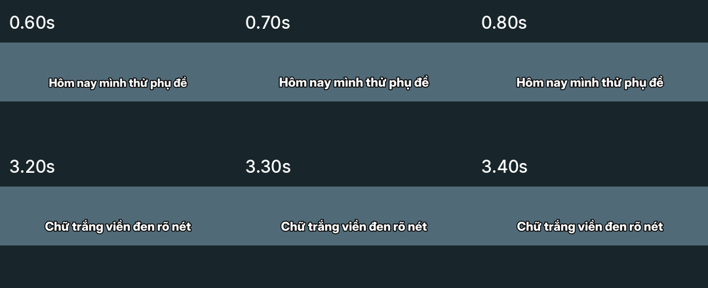

# Skill phụ đề riêng và video mẫu

- [Đọc skill.md](skill.md) — hướng dẫn độc lập, kèm mã nhận dạng và tạo đồ hoạ phụ đề.
- [Video mẫu MP4](demo.mp4) — 11,4 giây, 720×1280, H.264 Baseline và AAC im lặng.
- [Tải toàn bộ dưới dạng ZIP](subtitle-demo.zip).
- [Phụ đề ASS giữ thiết kế](captions.ass), [SRT chỉ giữ chữ và thời gian](captions.srt).

Nếu GitHub không phát MP4 trực tiếp, mở file rồi chọn **Download raw file**
(biểu tượng tải xuống), hoặc dùng các liên kết trực tiếp:

- [Tải MP4](https://github.com/StephenNgo420/VideoEdit/raw/refs/heads/main/examples/subtitle-only/demo.mp4)
- [Tải ZIP](https://github.com/StephenNgo420/VideoEdit/raw/refs/heads/main/examples/subtitle-only/subtitle-demo.zip)

Thiết kế: chữ trắng viền đen, không nền phụ đề, mỗi cụm 5–6 từ.
Chỉ cụm đầu tiên pop-up nhẹ 94% → 102% → 100%; các cụm sau đứng yên.
Demo dùng nền minh hoạ và thời gian đặt thủ công, không có lời nói và không
phải bài thử độ chính xác nhận dạng giọng nói.

File skill có thể tải riêng; font và dependency cần được chuẩn bị theo hướng
dẫn bên trong. Video mẫu đã được kiểm tra giải mã; phiên bản 1080×1920 trước
khi chuyển sang 720×1280 đã được kiểm tra cả chuyển động và font tiếng Việt.

